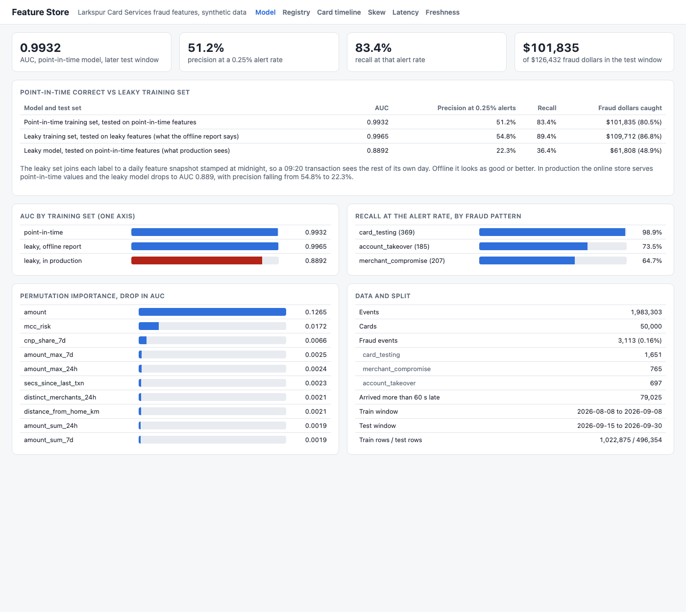
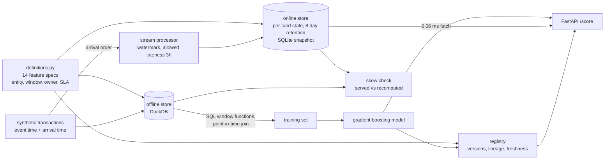

# Feature Store

A feature store for real-time card fraud scoring at Larkspur Card Services, a made-up card issuer. It shows the parts that are hard in production: features defined once and computed the same way online and offline, point-in-time correct training sets, a stream processor with event-time windows and late events, an online/offline skew check that catches a planted bug, and a scoring API that fetches features and scores in a few milliseconds. Everything runs on a laptop on 2 million synthetic transactions for 50,000 cards over 60 days.



## Results

Default build: 50,000 cards, 60 days, seed 7. 1,983,303 transactions, 3,113 of them fraud (0.16%): 1,651 card testing, 765 merchant compromise, 697 account takeover. 79,025 events arrive more than a minute late (up to 2 hours). The model trains on days 7 to 38 and is tested on days 45 to 60 (496,354 transactions, 761 fraud). The fraud team can review 0.25% of transactions.

**Point-in-time correctness vs a leaky training set**

| Model and test set | AUC | Precision at 0.25% alerts | Recall | Fraud dollars caught |
|---|---:|---:|---:|---:|
| Point-in-time training set, tested on point-in-time features | **0.993** | **51.2%** | **83.4%** | $101,835 of $126,432 (80.5%) |
| Leaky training set, tested on leaky features (the offline report) | 0.996 | 54.8% | 89.4% | $109,712 (86.8%) |
| Same leaky model, tested on what serving actually returns | 0.889 | 22.3% | 36.4% | $61,808 (48.9%) |

The leaky set makes a common mistake: aggregates come from a daily batch table stamped at midnight, joined to labels on card and date. A transaction at 09:20 then "knows" the rest of its own day, including the fraud burst that followed. Offline it looks better than the correct model. Once deployed, the online store serves point-in-time values and the model loses 0.107 AUC and more than half of its precision.

**Latency** (2,000 in-process requests on real cards from the last day, on a laptop)

| Stage | p50 | p99 |
|---|---:|---:|
| Online feature fetch (14 features) | 0.061 ms | 0.100 ms |
| Model score (gradient boosting, 16 inputs) | 2.80 ms | 4.68 ms |
| Total | 2.87 ms | 4.76 ms |

**Skew check** (563 transactions from 400 sampled cards, served vs recomputed): 0 mismatches on all 14 features with the bug flag off. With the planted off-by-one window bug on, 12 of 14 features mismatch, txn_count_1h on 100% of rows.

**Recall at the alert rate by fraud pattern:** card testing 98.9%, account takeover 73.5%, merchant compromise 64.7%.

Build time: about 55 seconds end to end (generate 2 s, stream processor 9 s at about 225,000 events a second, point-in-time and leaky training sets 10 s, training 8 s).

## Why

Most fraud models that disappoint in production were not bad models. They were trained on features that do not match what serving returns: a window computed slightly differently in the streaming job than in the SQL backfill, a join that let the label row see the future, a late event that one path counted and the other did not. These bugs do not throw errors. They show up months later as a model that scored 0.99 offline and catches half of what it should. A feature store exists to make one definition of each feature, compute it the same way in both paths, build training sets as of the moment of each decision, and prove the two paths agree.

## Architecture



| Piece | File |
|---|---|
| Feature specs (the DSL), sources | `src/featstore/definitions.py` |
| Synthetic transactions and the three fraud patterns | `src/featstore/generate.py` |
| Stream processor, online store, snapshots | `src/featstore/online.py` |
| Offline store, SQL generation, point-in-time and leaky training sets | `src/featstore/offline.py` |
| Skew check | `src/featstore/skew.py` |
| Model, time split, metrics | `src/featstore/model.py` |
| Registry, versioning, lineage, freshness | `src/featstore/registry.py` |
| Scoring and latency measurement | `src/featstore/scoring.py`, `latency.py`, `metrics.py` |
| Build pipeline, API, CLI, UI | `src/featstore/pipeline.py`, `app.py`, `cli.py`, `static/index.html` |

Details worth knowing:

- **One definition, two compilers.** A feature is a spec like `feature(name="txn_count_1h", aggregation="count", window_s=3600, source=..., owner=..., freshness_sla_s=60)`. The online path turns it into a bisect over the card's sorted events; the offline path turns it into `count(*) FILTER (WHERE NOT probe) OVER (PARTITION BY card_id ORDER BY ts RANGE BETWEEN 3600 PRECEDING AND 1 PRECEDING)`. Both mean `as_of - window <= ts < as_of` on integer seconds. Aggregations: count, sum, max, mean, distinct count, time since last, plus three request features (device seen before, distance from home, merchant category risk lookup).
- **Point-in-time join with window functions.** Each label row is unioned into the event table as a probe row at its as-of time. Frames end at 1 PRECEDING and aggregates count only real events, so a label row cannot see itself, events at the same second, or anything later. The same SQL handles any spine: every transaction for training, or arbitrary (card, time) pairs for the skew check.
- **Stream processor.** Events are consumed in arrival order. The watermark is the latest event time seen minus 3 hours of allowed lateness. A late event is inserted at its event-time position, so every window that should contain it does; anything older than the watermark is dropped and counted. Per-card state keeps 8 days of raw events (enough for the 7 day windows plus lateness) and a lifetime map of device first-seen times. State is snapshotted to SQLite and the API loads it at start.
- **Skew check and the planted bug.** Sample cards active in the last 24 hours, take their transactions, and compute every feature twice: from the online store and from offline SQL, at the same as-of time with the same request. The bug flag changes the online window's right edge from `ts < as_of` to `ts <= as_of`. The processor writes each transaction before it is scored, so with the bug every window counts the transaction itself. CI fails if any feature mismatches with the flag off, and fails if the check misses the flag on.
- **Registry.** A feature's version is the sequence of distinct hashes of its semantic fields (aggregation, column, window, default, source, entity). Owner and description edits do not bump it. The model records the version of every feature it was trained on; the API refuses to start if the live definitions moved. Lineage runs source to feature version to model.
- **Freshness.** Stream features: how far the online store's newest processed event trails the newest event in the source, against a 60 second SLA. Batch features (home location, category risk): age of the last table load against 24 hours. `featstore stream --limit 1000` stops the processor early and the stream features go red.
- **Synthetic data.** Cards have a home city, a spend rate, a typical amount, favorite merchants, and one to three devices. Legitimate noise that makes the problem harder: 6% of cards travel, 8% switch phones, 15% of online purchases geolocate to another city. Fraud: card testing (8 to 25 charges under $3 in minutes, then a large cash-out), account takeover (usually a new device, sometimes the home city, several large purchases in a few hours), and merchant compromise (cards used at breached merchants later see counterfeit in-person spend).

## How to run

Requires [uv](https://docs.astral.sh/uv/). Docker is optional.

```bash
cd feature-store
uv sync --python 3.12
uv run featstore build                  # 2M events, both stores, model, skew, latency (about a minute)
uv run featstore serve --port 8858      # UI and API on http://127.0.0.1:8858
```

Smaller and faster: `uv run featstore build --cards 3000 --days 30` (about 15 seconds).

Other commands:

```bash
uv run featstore skew --expect-clean           # served vs recomputed, exits 1 on any skew
uv run featstore skew --bug --expect-detected  # exits 1 if the planted bug is missed
uv run featstore stream --limit 1000           # replay only part of the stream, freshness goes red
curl -s -X POST localhost:8858/score -H 'content-type: application/json' \
  -d '{"card_id":123,"amount":480,"mcc":5732,"device_id":999999999,"lat":33.1,"lon":-80.2,"cnp":1}'
```

Endpoints: `POST /score`, `GET /features/{card_id}`, `/registry`, `/registry/{feature}`, `/lineage`, `/skew?bug=true&live=true`, `/freshness`, `/evaluation`, `/latency`, `/cards/{card_id}/timeline`, `/cards/examples`, `/healthz`, `/metrics` (Prometheus, with per-stage latency histograms). Logs are JSON lines with a request id.

The UI has six pages: model evaluation and the leak comparison, the feature registry with lineage, a card timeline (transactions and any feature's point-in-time value over time), the skew report with the bug flag toggle, latency, and freshness. It follows the system light or dark setting and works at phone width.

Docker (built and smoke tested in CI; Docker is not installed on the machine this was built on):

```bash
docker compose up --build    # processor job builds the stores, then the API starts on :8858
```

## Tests

85 tests, about 11 seconds: `uv run --group dev pytest -q`.

- Every window aggregate on hand-built event sequences, online and offline: left boundary inclusive, events at the as-of second excluded, the 7 day cap on time since last, late events placed by event time, events past the watermark dropped, retention pruning that keeps device history (17).
- Point-in-time join: a label never sees itself or later events, same-second ties, per-card partitions, arbitrary spines, and the leaky join that sees the rest of the day (8).
- Online vs offline equality on every feature for 400 transactions from a generated stream, the skew report clean with the bug off, catching it with the bug on, and snapshot round trips (8).
- Model: time split with a gap, precision, recall and dollars at the alert rate on hand data, training on a planted signal, the leak lowering production AUC (8).
- Latency plumbing: histogram buckets, percentiles, the timer, Prometheus output, separate fetch and score timing (7).
- Registry: idempotent registration, version bumps on semantic changes only, stale model detection, lineage, freshness status (9).
- Generator, CLI gates, and the API end to end through FastAPI's test client (28).

## Concepts mapped to real feature stores

| Concept here | Feast | Tecton | Cloud feature stores |
|---|---|---|---|
| `feature(...)` spec in `definitions.py` | `FeatureView` with `Aggregation`, `Entity` | `@stream_feature_view` with `Aggregate` | Vertex AI feature groups, SageMaker feature groups, Databricks feature tables |
| Card entity | `Entity(join_keys=["card_id"])` | `Entity` | Entity id column |
| Stream processor with watermark | Push source plus your own Flink or Spark job | Managed streaming aggregation, tiled windows | Kinesis or Pub/Sub plus Flink or Dataflow, then ingest API |
| Online store (SQLite snapshot here) | Redis, DynamoDB, Bigtable online store | DynamoDB or Redis, managed | Vertex online serving (Bigtable), SageMaker online store |
| Offline store (DuckDB here) | BigQuery, Snowflake, Redshift, file offline store | Spark or Snowflake offline store | BigQuery, S3 offline store via Athena, Delta tables |
| Point-in-time join with probe rows | `get_historical_features` | `get_features_for_events` | `batch_serve_to_bq`, SageMaker dataset builder, `create_training_set` |
| Request features (device, distance, category) | `OnDemandFeatureView` | `on_demand_feature_view` | Computed in the serving function |
| Skew check | Not built in (log features and compare) | Feature logging plus monitoring | Vertex and SageMaker model monitoring for skew and drift |
| Version by semantic hash | Registry versions per apply | Workspaces and plan/apply diffs | Feature group versions |
| Freshness SLA per feature | Materialization intervals, TTL | Freshness monitoring and alerts | Ingestion metrics |

## Production notes

- **Tiled aggregations instead of raw events.** The online state keeps 8 days of raw events per card, which is fine for 50,000 cards and about 10 events a card a day. At hundreds of millions of cards and merchant-level entities with millions of events, keep pre-aggregated tiles (for example 5 minute partial sums) and combine tiles plus a raw tail at read time, the way Tecton does.
- **A real stream processor and online store.** Flink or Spark Structured Streaming with checkpointed keyed state, consuming from Kafka, writing to Redis or DynamoDB with per-key TTLs. The watermark and lateness rules here map directly to Flink's.
- **Bitemporal point-in-time joins.** This join uses event time. If the stream processor in production applies an event only when it arrives, a training row should only see events that had arrived by its decision time. Store ingestion time in the offline store and join on both.
- **Skew from feature logging.** Log the exact vector served for a sample of real requests and compare it to the backfill later, instead of recomputing online values after the fact. Run it continuously and alert per feature.
- **Labels arrive late.** Chargebacks come in 30 to 90 days after a transaction. Training windows have to end where labels are mature, and evaluation has to account for labels still missing.
- **Faster scoring.** Most of the 2.8 ms is scikit-learn's per-call overhead on one row. Compiled trees (Treelite, ONNX Runtime) or a native GBM library bring single-row scoring well under a millisecond.

## License

MIT. See [LICENSE](LICENSE).
